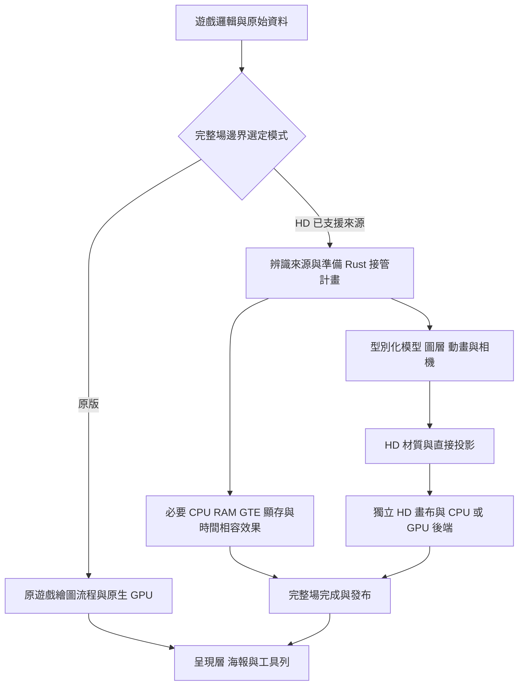

# PS1 3D 繪圖攔截（hook）、HD 素材與視野控制

本文件說明 ps-golem 如何在原遊戲繪圖途中攔截資料，交由 Rust 直接繪製，並以《月下的夜想曲》的已驗切片說明限制。原始幾何／呈現基準為 [e16b4f9](https://github.com/wicanr2/ps-golem/commit/e16b4f9e2b3d34a4c6ab0a3278f492ffdf03a90d)。

這是技術說明，不是新增功能的 READY 規格。既有實作以 [026 Rust 遷移](spec/026-rust-migration.md)、[017 寬螢幕與可調視野](spec/017-sotn-widescreen.md)及各節驗證範圍為準。「後續做法」尚未接到正式玩家。

## 1. 攔截哪一段，決定能改善什麼

要保留深度、提高素材細節或改變相機，最有用的攔截位置在原始場景資料轉成螢幕座標之前。此時仍有模型頂點、物件姿勢、相機、材質與圖層關係，可以直接交給新的繪圖器。

| 攔截位置 | 還能取得什麼 | 適合用途 | 限制 |
|---|---|---|---|
| 最後畫面輸出 | 已完成的像素 | 縮放、濾鏡、海報合成 | 難以恢復被遮擋物件、深度或原始幾何 |
| GPU 命令入口 GP0 | 螢幕 XY、UV、顏色、材質頁等 | 通用高解析度光柵、材質替換 | 命令本身沒有原模型與完整相機資料；已剔除的物件也不在其中 |
| GTE 投影附近 | 當次頂點、矩陣、投影與深度線索 | 次像素追蹤、透視取樣 | 還要追查頂點寫回、重用與所屬物件，不能只按 XY 配對 |
| 遊戲的模型／圖層繪圖來源 | 原頂點、格子、相位、姿勢、相機與資源身分 | 直接 Rust 繪圖、完整材質替換、研究新視野 | 需要按遊戲與版本證實來源及必要副作用 |

PS1 的 GTE 負責幾何變換與投影；GPU 接收投影後的圖元資料。原 GPU 的貼圖插值採仿射方式，透視取樣需要額外保留深度。硬體資料見 [psx-spx：GTE](https://psx-spx.consoledev.net/geometrytransformationenginegte/)與 [GPU 的多邊形及透視說明](https://psx-spx.consoledev.net/graphicsprocessingunitgpu/)。

目前專案的主方向採最後一列：由 Rust 讀原始資料建立型別化幾何。GP0 與原 CPU 執行可作驗證來源；正式 HD 主流程不依賴先完成原版光柵，再覆蓋新圖。



圖中完整場接管是目標架構。現有單一函式或保存來源通過，仍不足以啟用圖中的整場 HD 分支。

## 2. 「中途攔截」在執行器中怎麼做

### 2.1 優先選語意完整的入口

SDK 是軟體開發套件（Software Development Kit）。本文件的 SDK 呼叫指原片連結的繪圖函式庫，負責包裝繪圖環境、同步與 DMA 提交。接管時要保留 GPU 控制、顯存與時序效果，來源仍須逐個呼叫證實；原名稱與 bytes 的入口見 [026 §16.15](spec/026-rust-migration.md#1615-st0繪圖環境與sdk提交)。

ps-golem 控制 CPU 的執行分派，可在 PC 抵達已證實的繪圖入口時辨識呼叫。這不需要在遊戲內插入另一段 PS 組合語言。原函式的組合語言供研究資料流、返回與副作用，替代流程直接寫 Rust。

《月下》目前的例子：

| 原始定位 | 角色與證據 | Rust 入口 |
|---|---|---|
| ST0 `0x801BAEB0` | 鐘塔初始化、活動、配置失敗與限定刪除；026 §16.9.11–13 | [tower.rs](../rust/player/src/apps/sotn/tower.rs) |
| ST0 `0x801BA70C` | 兩層格子表與物件相位直接生成程序式平面；026 §16.9.14 | [planes.rs](../rust/player/src/apps/sotn/planes.rs) |
| ST0 `0x801BA70C` 的生命週期 | 112連續槽初始化／配置失敗／限定刪除；026 §16.9.19 | [planelife.rs](../rust/player/src/apps/sotn/planelife.rs) |
| 上述平面幾何的呈現端 | 原生／HD 各自建立畫布；026 §16.9.15 | [planeview.rs](../rust/player/src/apps/sotn/planeview.rs) |

位址空間為 PS1 KSEG0；這份 ST0 輸入的檔案偏移為 `EA - 0x80180000`。位址只負責定位，實作還核對來源程式／表格雜湊與狀態範圍，不能用相同 PC 推定不同版本仍相容。公開庫保存程式與證據說明，不附原片、RAM 或原始遊戲資料。

若入口在函式中段，必須先證實前段已完成的效果、當前暫存器與堆疊、延遲分支／載入狀態，以及所有離開路徑。遇到尚未封閉的分支便停止接管。任意把 PC 跳到返回位址，不能當作完成替代。

### 2.2 畫面與相容效果分開建立

一個繪圖 routine 可能同時修改物件相位、配置圖元、上傳貼圖、留下 GTE 狀態、更新快取，並消耗裝置可觀測的虛擬時間。略過舊光柵工作時，這些必要效果仍要依已證實契約保留。

| 類別 | 接管時保留的內容 |
|---|---|
| CPU | 返回 PC、暫存器、堆疊、延遲載入與快取狀態 |
| RAM／暫存區 | 動畫相位、物件配置與回收、索引、必要的中間資料 |
| GTE | 後續程式會讀取的暫存器與完成時間 |
| 顯存 | 遊戲仍會讀取或取樣的上傳、搬移與相容像素 |
| 時間與裝置 | 原虛擬週期、IRQ、DMA、音訊與場邊界 |
| HD | 原模型與直接相機投影、獨立材質與畫布 |

現有範例採 `prepare → commit`。`prepare` 只讀資料、核對來源並建立計畫；`commit` 再核對狀態未過期，提交必要效果與時間。具體守門依各切片而異，見 [toweractive.rs](../rust/player/src/apps/sotn/toweractive.rs)、[towerinit.rs](../rust/player/src/apps/sotn/towerinit.rs)與 [machine/phase.rs](../rust/src/machine/phase.rs)。

不能把主機執行變快，誤寫成遊戲虛擬時間縮短。Rust 少做指令解碼或原光柵工作，可降低主機成本；遊戲與裝置仍沿約定的虛擬時鐘前進。速度須另外以同輸入、同場景、同後端量測。

### 2.3 整場與回退邊界

- 原版模式沿原流程；HD 模式在完整場邊界選定，避免半場交替。
- 準備失敗或狀態過期時，不能留下半段 RAM／CPU 修改，再補跑半段原 routine。
- 已略過原光柵後，不能假設當場原生畫面仍完整。若要回原版，必須有已驗證的完整場檢查點／重播策略；否則該來源不能啟用正式整場接管。
- 缺少 HD 材質時，可以在同一個新繪圖器中改用原材質。這仍由直接幾何繪製，不必執行舊光柵。

完整場檢查點、跨來源協調與正式玩家接線仍屬待完成項目，見 [Issue #17](https://github.com/wicanr2/ps-golem/issues/17)。

## 3. 攔截後怎麼強化 3D 素材

### 3.1 保留來源身分，再替換表面

現有材質鍵由上傳資料形狀與內容、色盤內容建立。`planeview.rs` 依 UV 選取原始 4bpp 資料與色盤，交給 [texture_audit.rs](../rust/player/src/texture_audit.rs)查找 HD 素材。不能只用 VRAM 位址或螢幕位置作身分，兩者都可能被重用。

| 保留的資料 | 可支持的強化 |
|---|---|
| 上傳與色盤身分 | 同圖異色、動畫頁與場景切換時，選對素材 |
| UV 與圖集區域 | 提高貼圖解析度，同時維持原圖元的取樣位置 |
| 世界頂點與相機 | 次像素投影、透視校正，後續研究替換模型 |
| 排序、混色與遮罩 | 保留前後層、特效、透明與半透明語意 |
| 物件／動畫來源 | 後續建立姿勢或整個物件的替換，而不靠畫面猜測 |

現有全彩素材沿 [018](spec/018-hd-texture-replacement.md)與 [019](spec/019-hd-texture-pack.md)：RGBA 圖像加獨立半透明位元遮罩。半透明位元還受混色模式及圖元屬性影響，不能逕自把它視為固定 50% 的一般 alpha。

更高解析度的貼圖可在主機端材質中保存。遊戲可見的原生 VRAM 仍依 PS1 契約存在；HD 畫布與主機 GPU 材質是另一組資源。直接擴大原 VRAM 配置，會牽動位址、DMA 與讀回契約，無法單靠增加記憶體達成 HD。

### 3.2 從原模型到透視取樣

在有效投影域中，可以用下列概念式理解相機；它不是 PS1 整數飽和／除法的精確替代：

```text
相機空間頂點 = R × 原模型頂點 + T
x = cx + f × X / Z
y = cy + f × Y / Z
```

現有 [projection.rs](../rust/src/projection.rs)分開提供原生整數回退與 HD 投影。深度不可靠時會回到原座標與仿射取樣；其飽和、近端與座標範圍守門不可從上述簡式刪掉。

對三角形上的螢幕重心權重 `λi`，透視 UV 的概念式為：

```text
u = Σ(λi × ui / zi) / Σ(λi / zi)
v = Σ(λi × vi / zi) / Σ(λi / zi)
```

這需要可靠的逐頂點深度與相同來源關聯。只有最後 XY 時，不能任意補一個 Z 當作正確深度。現有取樣入口為 [paint.rs 的 draw_projected](../rust/src/paint.rs)，Go 相容路線的契約另見 [022 透視校正](spec/022-hd-texture-perspective.md)。

### 3.3 材質接縫要在來源處理

一張圖集相鄰的兩格，在遊戲裡可能完全不相鄰。先把整張光影圖放大，可能混入錯誤鄰格的顏色；直接替整張圖集加線性取樣，也可能取到別的區域。

後續素材編製須追查實際拼接關係、UV 區域、圖塊邊緣與色盤變體。需要邊緣延展或留白時，連同 UV 與取樣範圍一起處理。最後畫面整張模糊，會連人物、字與正常灰縫一併損失。這些原則適用於 CPU 與主機 GPU 後端，不能只在其中一端修圖。

## 4. 解析度、縮放、視野與視點分別控制

使用者說「拉大像素／畫布」時，要先對照實際希望改變的量：

| 控制項 | 實際改變 | 是否自動看到更多場景 |
|---|---|---|
| 視窗輸出解析度 | 最後呈現的像素尺寸，例如 1920×1080 | 否 |
| 內部繪製倍率 | 同一可見範圍分配更多像素與材質樣本 | 否 |
| 畫面縮放 | 人物、背景在螢幕上的大小 | 放大時通常看到較少 |
| 2D 可見視窗 | 直接選取更大的世界座標範圍，例如 800×600 | 資料已載入且剔除已擴充時才成立 |
| 3D 視點與投影 | 相機位置、方向、焦距與可見範圍 | 依原始幾何與載入範圍而定 |
| 兩側海報 | 呈現層裝飾與融合 | 否 |

### 4.1 提高解析度，維持原有視角

若世界可見範圍是 `W × H`，內部倍率為 `s`，內部畫布便是 `sW × sH`。提高 `s`，沿用相同相機與可見範圍，可保留構圖並增加取樣密度。還要有足夠的 HD 素材，才能增加表面細節。

目前原生尺寸 `256×240` 的四倍畫布為 `1024×960`。視窗設定 1080p，不等於這張內部畫布已達 1080 行。`480×270` 邏輯視野的四倍畫布則是 `1920×1080`，但它已經改變世界可見範圍。

若要保留原視野又達到更高內部像素密度，需在後續規格擴充倍率或目標畫布尺寸，再校準最終等比呈現。現在 `planeview.rs` 僅接受 1／4 倍，不能把任意倍率寫成已支援。PS1 顯示模式的像素長寬比也須納入校準，勿將原生像素比例直接等同螢幕比例。

### 4.2 擴大 2D 可見範圍

現有 [scene.rs](../rust/player/src/apps/sotn/scene.rs)的 `Viewport` 可在保存來源預覽中設定到 `800×600`。它重新從駐留的圖層表選格，能畫出原小視窗以外、已在資料中的圖塊。

在預覽中改可見視窗，不需要放大人物的世界尺寸，也不等同修改遊戲相機。工具列與 CLI 的實作範圍見 [026 §16.7.21](spec/026-rust-migration.md)。以下是**容器內**的既有保存來源命令；`INPUT.json` 須指向本機合法來源及其雜湊：

```text
psgolem-player -render-sotn-view INPUT.json -viewport 800x600
psgolem-player -preview-sotn-view INPUT.json -viewport 800x600 -posters DIR
```

這兩個入口不啟動 Machine。正式連續遊玩還需要處理：

- 圖層剔除與捲軸邊界，包含前景、背景與不同捲動比例。
- 鄰房資料載入、切場與遮擋，不能重複目前畫面填滿空白。
- 框外人物／怪物的生成、更新及剔除；背景畫得出來不代表怪物已存在。
- HUD、姓名與文字仍用螢幕座標定位，避免隨世界視野一起縮小。

目前 `planes.rs` 的 3D 面可見性仍有原窗口的邊界判定，`planeview.rs` 也固定原尺寸／四倍畫布。它們尚未承接 NO3 的可調視野；只把畫布加寬，不能讓原先已被剔除的 3D 面重新出現。

### 4.3 固定螢幕時，視野越大人物越小

以垂直方向為例，忽略海報、留邊與像素比例校準時：

```text
人物螢幕高度 = 人物世界高度 × 遊戲區輸出高度 / 可見世界高度
```

假設人物高 16 世界單位、遊戲區高 1080 像素：可見高度 240 時人物約 72 像素，可見高度 600 時約 28.8 像素。增加內部倍率可提高這個小人物的取樣精度，無法同時保持人物螢幕大小並無限增加視野。

若希望人物更大，控制項應是縮放或投影；若希望同時看到更大區域，控制項是可見範圍。兩者要分開保留，才能讓工具列的數值有明確意思。

### 4.4 改變 3D 視點（viewpoint）

對可用針孔相機近似的有效區域，在相同邏輯像素單位下：

```text
水平視角 = 2 × atan(邏輯視窗寬度 / (2 × 焦距))
```

| 改動 | 影響 | 後續須封閉的資料 |
|---|---|---|
| 保持焦距，擴大邏輯視窗 | 看見更寬範圍 | 更大的剔除邊界、候選幾何與載入範圍 |
| 改焦距 | 改變投影比例與視角 | 近端處理、精度與回退契約 |
| 移動相機 | 改變物件相對深度與透視關係 | 相機語意、遮擋與未顯示表面 |
| 旋轉相機 | 看到不同方向 | 背面、模型完整性、精靈朝向及排序 |

目前 `Camera` 的平移是世界頂點到相機空間變換的一部分。要控制世界中的相機位置，須先依該遊戲的座標約定換算，不能把平移欄位直接當作任意方向的相機移動量。

《月下》混合 2D 人物、圖層及局部 3D 背景。能改鐘塔 3D 投影，不代表整個城堡已有可自由環繞的完整模型。改變視點可能露出未製作的背面、圖層空洞與未載入房間；這些資料需要另外證實或製作。新增 GPU 深度測試也不能直接取代原排序，因為混色、2D 疊層與特效可能依賴原順序。

## 5. 原版狀態與呈現相機的邊界

| 做法 | 機器狀態契約 |
|---|---|
| 只在 HD 呈現端換材質、提高取樣密度 | 保持同輸入的原生狀態 |
| 唯讀已駐留資料，另選較大的呈現範圍 | 在已封閉的來源內可保持原生狀態；不因此增加遊戲物件 |
| 修改遊戲剔除、生成、載入或原相機 RAM | 屬明確開啟的遊戲修改，沿017；不能當同態驗收 |

後續改視點時，呈現用相機與原生相容狀態必須分開。視覺矩陣不應直接覆寫遊戲稍後會讀的 GTE／RAM。純呈現模式可保留原生邏輯；若為看見更多區域而改到生成或載入，則另走已定案的遊戲修改模式。

海報沿 [024](spec/024-poster-presentation.md)在最後呈現層合成，與遊戲邏輯視野分開。原版、HD、CPU／GPU及海報支援都保留；新增視點能力不默認改變既有玩法或顯示偏好。

## 6. 現況、驗證與後續接線

| 能力 | 已有範圍 | 仍待完成 |
|---|---|---|
| 原始鐘塔模型 | 026 §16.9.2–3：18面模型、原始頂點與相機來源 | 全場景模型及正式整場呈現 |
| 鐘塔 routine 替代 | 026 §16.9.11–13：限定初始化／活動／生命週期及同步提交證據 | 正式玩家註冊、其餘種類與自然事件覆蓋 |
| 程序式平面 | 026 §16.9.14–19：直接HD畫布；完整資料／CPU／時鐘、112連續槽生命週期及自然初始化／活動Machine相同 | 自然失敗／刪除覆蓋、完整場協調及正式玩家 |
| ST0共同場 | 026 §16.10：場初始化、平面／鐘塔、捲動及seal；三Epoch／九階段同Machine，97圖元共同CPU畫布 | 其他來源、完整遊戲合成、正式玩家與GPU／速度 |
| ST0序章HUD與3D | 026 §16.11：八HUD與97個3D共同畫布，原裁切／底色及12階段同Machine，原生對封包GPU相同 | 其他來源、人物獨立封包、正式整場與GPU／速度 |
| 人物材質元件 | 026 §16.12.1：[ActorView](../rust/player/src/apps/sotn/actorview.rs)已與NO3背景解耦；四個ST0保存raw圖元全HD、原生同原GT4 | 正常ST0共同場由16.12.3承接；其他來源與正式整場仍待 |
| ST0人物／3D／HUD | 026 §16.12.3：[fieldactors.rs](../rust/player/src/apps/sotn/fieldactors.rs)協調三Epoch／15階段全Machine，109圖元共同CPU-HD畫布 | 場景精靈由16.13承接；其餘來源、正式整場玩家與GPU／速度 |
| ST0背景／前景共同場 | 026 §16.13：[fieldscene.rs](../rust/player/src/apps/sotn/fieldscene.rs)依3D→背景→人物→前景→HUD直接繪製；259圖元全HD、18階段正常Machine通過 | staged API，正式玩家分派／完整呈現交易、其他場景與GPU／速度仍待 |
| 完整場來源發布 | 026 §16.14：[present.rs](../rust/player/src/apps/sotn/present.rs)分待提交／已提交／顯示；兩個實際Scanout像素相同，來源可在原列表前備妥 | SDK／DMA與native cache效果仍待，未接GUI／未略過原光柵 |
| 環境SDK提交 | 026 §16.15：[envsubmit.rs](../rust/player/src/apps/sotn/envsubmit.rs)與[GPU環境](../rust/src/gpu/environment.rs)直接設定環境／底色及DMA末態；24階段正常Machine同 | 僅76-byte環境提交helper，上層環境／display、整場圖元cache／DMA與GUI仍待 |
| 顯示原點／模式 | 026 §16.16：[displaysubmit.rs](../rust/player/src/apps/sotn/displaysubmit.rs)從DISPENV建立控制，在指定量子改GPU並保留RAM shadow；30階段正常Machine同 | 僅兩個控制，上層SDK／整場圖元cache／DMA與GUI仍待 |
| 原生快取與按需影像預備 | 026 §16.17：[scene.rs](../rust/src/gpu/scene.rs)接受型別化多邊形／精靈，先保留快取而不寫像素；明確native查詢才產生並重用影像，四保存態／九拒絕通過 | 通用元件，尚未接SotN原資料、SDK／DMA、live VRAM與GUI；掃描／UV取樣仍有成本，非速度驗收 |
| ST0原生工作來源 | 026 §16.18：[nativework.rs](../rust/player/src/apps/sotn/nativework.rs)從語意圖元池、typed Tile／Actor與scratch metadata建工作，三epoch／30階段Machine及GPU副本相同 | 原生相容資料，HD主幾何沿既有模型producer；live DMA／按需VRAM與GUI仍待 |
| 有界按需原生像素 | 026 §16.19：[deferred.rs](../rust/src/gpu/deferred.rs)保留最多兩區域、完整覆寫可取消，vram／screen或部分寫入時才物化；12覆寫／八需求案例／四拒絕通過 | 通用元件，Machine／DMA與GUI未接；現有全vram來源查詢仍會觸發原生需求，須接區域來源 |
| ST0直接場景DMA／來源讀取 | 026 §16.20：[scenesubmit.rs](../rust/player/src/apps/sotn/scenesubmit.rs)按四時點直接交typed工作，三提交／33階段Machine與原音同；[source.rs](../rust/src/gpu/source.rs)只需求所讀目標，HD畫布SHA保持 | 正常無頭證據保持，限定玩家GUI／模式由16.21承接；其他場景與GPU呈現／速度仍待 |
| ST0玩家場景與模式分派 | 026 §16.21：[game.rs](../rust/player/src/apps/sotn/game.rs)接既有直接來源／DMA與整場發布；F3或工具列切換，保存素材路徑，1080p海報與兩個既有HD畫布RGBA相同 | 限定ST0正常路線；未知來源回原版，全遊戲、GPU光柵及速度仍待。呈現身分與原生物化分離，不先畫原版螢幕再換圖 |
| 零可見人物 | 026 §16.22：[fieldactors.rs](../rust/player/src/apps/sotn/fieldactors.rs)與[nativework.rs](../rust/player/src/apps/sotn/nativework.rs)接受0..32人物，空集合保留場景／HUD／3D；六項注入抽驗完整Machine與原音同原CPU | 注入診斷，不代表自然隱身事件或其他場景；完整玩家／GPU與速度範圍保持 |
| ST0空背景圖塊 | 026 §16.23：[call.rs](../rust/player/src/apps/sotn/call.rs)允許背景可見ID為空且前景仍非空；四正向逐階段Machine／原音同原CPU，保留48模式與原scratch末態 | 僅注入抽驗，NO3及兩層全空仍按原守門；自然觸發與全遊戲另驗 |
| NO3 可調視野 | 026 §16.7.21：保存來源到800×600 | 連續遊玩、跨房與框外物件 |
| 任意 3D 視點 | 已有型別化相機與原始幾何基礎 | 新視點、剔除、遮擋與來源覆蓋的專門規格／驗證 |
| 1080p 與後端 | 已有1080p保存預覽；CPU／GPU支援按各規格範圍承接 | 新路線的完整遊玩、GPU與速度驗收 |

同一切片集中抽驗以下項目，不重審已核准美術：

1. **來源與效果：** 原始資料身分、完整CPU／RAM／GTE／顯存與逐項時間成本。只驗幾何時便明列該限制。
2. **直接性：** 在副本毒化原圖元座標、封包或舊輸出；新HD仍由原始模型／圖層資料產生。
3. **呈現：** 原材質／HD、仿射／透視與兩後端按適用契約比較，檢查透明、混色、邊界與子貼素細節。
4. **視野：** 原窗口重疊區保持，新增區域有真實來源；另測房界、剔除與物件生成，不以拉伸或黑邊當擴大成功。
5. **正常路徑：** 原版與HD從等價存檔及輸入走同一路線；正常、注入診斷與保存來源收據分開。

已通過切片直接承接。程序式平面的完整資料／CPU／快取／時間與限定生命週期，已由026 §16.9.16–19封閉，正常初始化／連續活動的同步提交亦已比較。ST0兩個3D來源已由026 §16.10接到共同Epoch與排序畫布；這是子圖層。下一段補其餘繪圖來源與完整合成，再接正式玩家及視野擴充。未驗分支維持 DRAFT；文件中的相機公式與後續做法不能代替 READY 契約。

## 7. 程式與規格入口

| 要研究的問題 | 入口 |
|---|---|
| 原始幾何如何產生 | [planes.rs](../rust/player/src/apps/sotn/planes.rs)、[mesh.rs](../rust/player/src/apps/sotn/mesh.rs) |
| 相機與原生回退 | [projection.rs](../rust/src/projection.rs)、[camera.rs](../rust/player/src/apps/sotn/camera.rs) |
| 幾何如何接到材質／畫布 | [planeview.rs](../rust/player/src/apps/sotn/planeview.rs)、[paint.rs](../rust/src/paint.rs) |
| 替代呼叫如何保留機器效果 | [fieldhud.rs](../rust/player/src/apps/sotn/fieldhud.rs)、[hudst0.rs](../rust/player/src/apps/sotn/hudst0.rs)、 [field3d.rs](../rust/player/src/apps/sotn/field3d.rs)、 [planelife.rs](../rust/player/src/apps/sotn/planelife.rs)、 [planeclock.rs](../rust/player/src/apps/sotn/planeclock.rs)、[planecommit.rs](../rust/player/src/apps/sotn/planecommit.rs)、[planestate.rs](../rust/player/src/apps/sotn/planestate.rs)、[tower.rs](../rust/player/src/apps/sotn/tower.rs)、[machine/phase.rs](../rust/src/machine/phase.rs) |
| 2D 可見視窗與場景選格 | [scene.rs](../rust/player/src/apps/sotn/scene.rs)、[view.rs](../rust/player/src/apps/sotn/view.rs) |
| 材質載入與身分核對 | [texture_audit.rs](../rust/player/src/texture_audit.rs)、[019](spec/019-hd-texture-pack.md) |
| 正式契約與工作狀態 | [規格索引](spec/000-index.md)、[026](spec/026-rust-migration.md)、[017](spec/017-sotn-widescreen.md)、[Issue #17](https://github.com/wicanr2/ps-golem/issues/17)、[Issue #18](https://github.com/wicanr2/ps-golem/issues/18) |

外部硬體說明採 psx-spx 的 [GTE](https://psx-spx.consoledev.net/geometrytransformationenginegte/)與 [GPU](https://psx-spx.consoledev.net/graphicsprocessingunitgpu/)文件，只引用介面與行為說明；本文件沒有移植外部模擬器程式碼。

026 §16.24補ST0兩層圖塊皆空的接線：圖層View可為空，48模式與原CPU／scratch必要末態保持，3D／HUD／人物仍以直接資料呈現。四局部與一次共用基準的注入Machine／原音已限定核對；正常事件、其他場景與完整HD仍待。原版／海報與兩後端選項沿原契約。
